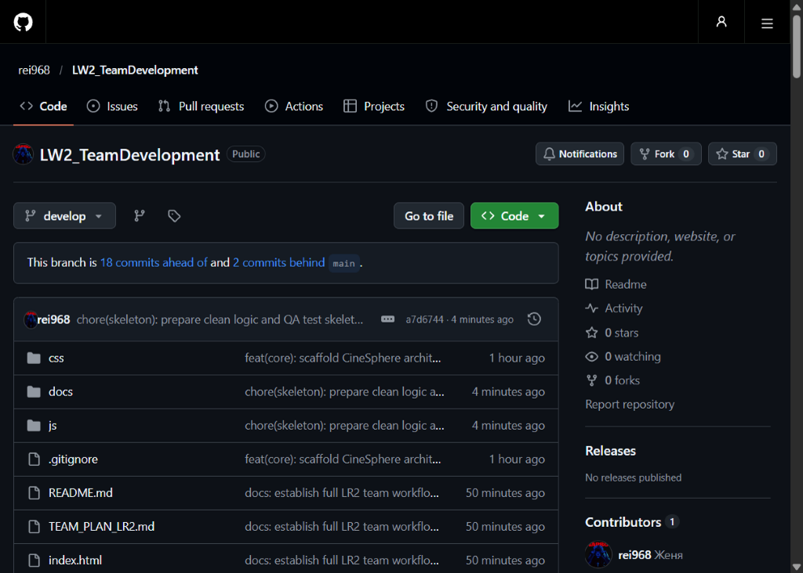

# 📊 Звіт про стан репозиторію та хід виконання LR2
> **Проєкт:** CineSphere 🎬 — Cinema Showcase & Ticket Booking Platform  
> **Репозиторій:** [rei968/LW2_TeamDevelopment](https://github.com/rei968/LW2_TeamDevelopment)  
> **Тімлід (Же):** `@rei968`  
> **Дата:** 20 листопада 2026

---

## 📌 1. Поточний стан гілки `develop` на GitHub

Гілка `develop` налаштована як чиста інтеграційна база для команди:
- **Останній коміт:** `a7d6744` — *"chore(skeleton): prepare clean logic and QA test skeletons with TODOs for Yarik and Illia"*.
- **Автор:** `rei968 <comfy.client.15032@gmail.com>`.
- **Код Яріка (`js/booking.js`, `js/pricing.js`)**: очищено від реалізації та підготовлено чисті шаблони з коментарями `// TODO (Ярік)` для самостійної розробки в гілці `feature/yarik-booking-logic`.
- **Код Іллі (`tests.html`, `docs/TESTING.md`)**: очищено від готових наборів тестів та підготовлено структуру для самостійного написання в гілці `feature/illia-qa-tests`.

### 📷 Скріншот дерева гілки develop на GitHub:

---

## 🎨 2. Виконана робота Же (Frontend 1)

Роботу Тімліда з розробки інтерфейсу вітрини виконано в окремій гілці:
- **Робоча гілка:** `feature/zhe-catalog-ui`
- **Коміт:** `56de91c` — *"feat(catalog): enhance catalog showcase with hover zoom, format badges, and search reset"* (Автор: `rei968`).
- **Змінені файли:**
  - `index.html` — розмітка навігації, живого пошуку та структури каталогу;
  - `css/components/header.css` — стилізація шапки та переходів;
  - `css/components/catalog.css` — картки фільмів, hover-анімації, бейджі форматів (IMAX/3D/Dolby Atmos), кнопка швидкого очищення пошуку;
  - `js/ui/catalogView.js` — рендеринг списку сеансів та динамічна фільтрація за назвою й жанром.

👉 **Посилання для створення Pull Request:**  
[Створити PR: feature/zhe-catalog-ui -> develop](https://github.com/rei968/LW2_TeamDevelopment/pull/new/feature/zhe-catalog-ui)

---

## 👥 3. Зони відповідальності одногрупників

| Учасник | Роль | Гілка | Файли для роботи | Що робить |
| :--- | :--- | :--- | :--- | :--- |
| **Же** (`@rei968`) | Team Lead & Frontend 1 | `feature/zhe-catalog-ui` | `index.html`, `catalog.css`, `header.css`, `catalogView.js` | Вітрина, каталог фільмів, навігація, код-рев'ю |
| **Ярік** (`@YaroslavYanushevych`) | JS / Logic Lead | `feature/yarik-booking-logic` | `js/pricing.js`, `js/booking.js` | Динамічне ціноутворення, націнки VIP, валідація ліміту 6 місць, симуляція конфлікту |
| **Льоша** (`@oleksiystratonov`) | Frontend 2 & Hall UI | `feature/lyosha-hall-ui` | `css/components/hall.css`, `css/components/modal.css` | Схема залу, вигнутий екран, категорії сидінь, модальне вікно квитка |
| **Ілля** | QA Engineer | `feature/illia-qa-tests` | `tests.html`, `docs/TESTING.md` | Написання автотестів, чек-ліст ручного тестування, звіт дефектів |

---

## 📂 4. Галерея скріншотів операцій Git

Усі скріншоти автоматично зберігаються в директорію `screenshots/` і фіксуються в цьому звіті:
1. `screenshots/01_develop_tree_status.png` — стан віддаленої гілки `develop` на GitHub з останнім комітом від `@rei968`.
