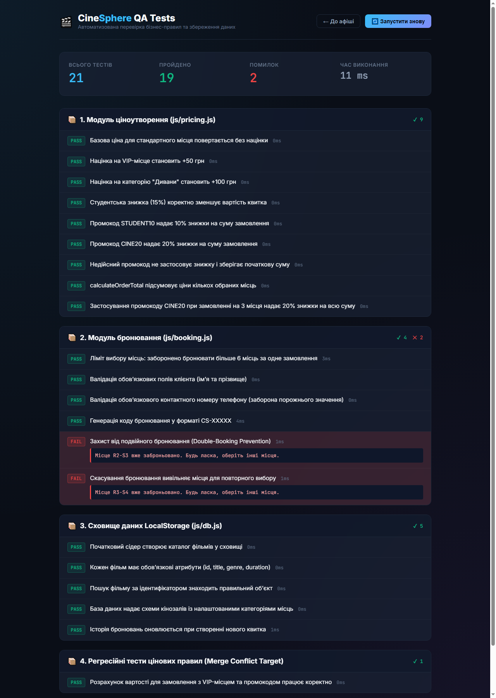
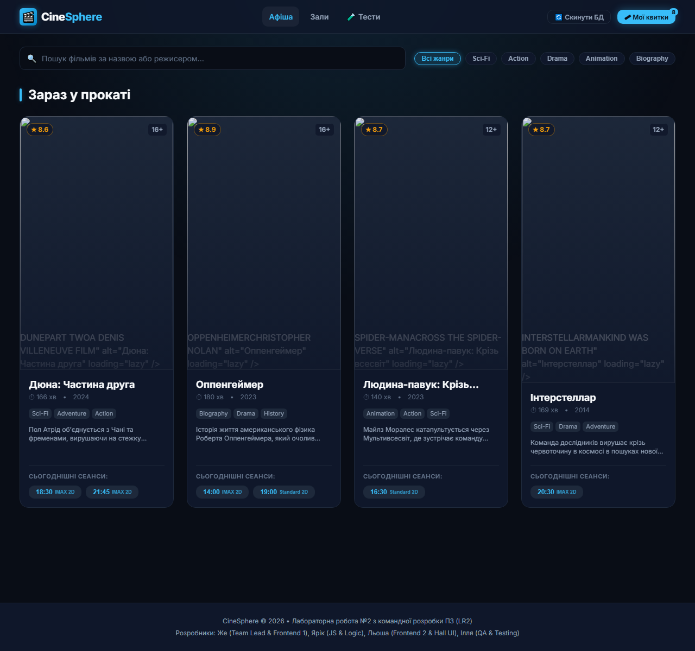
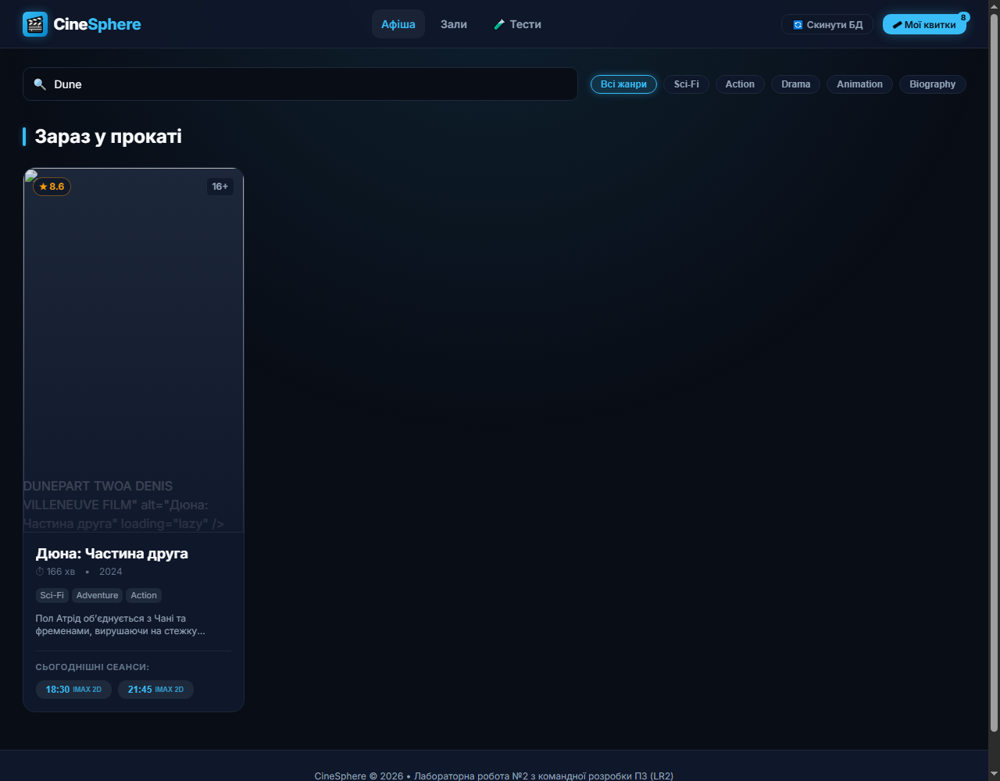
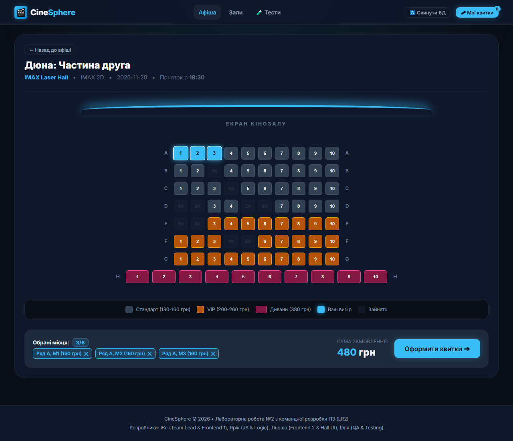
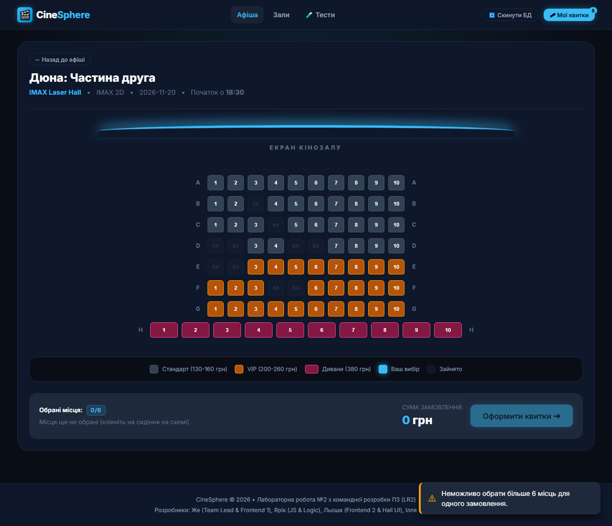
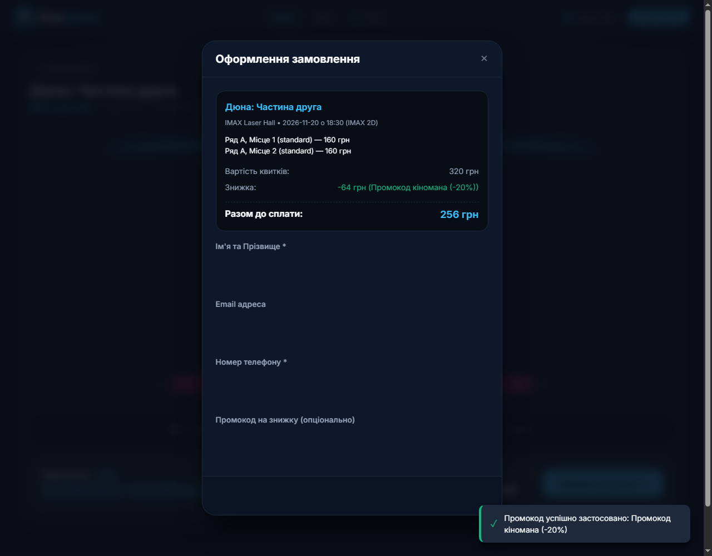
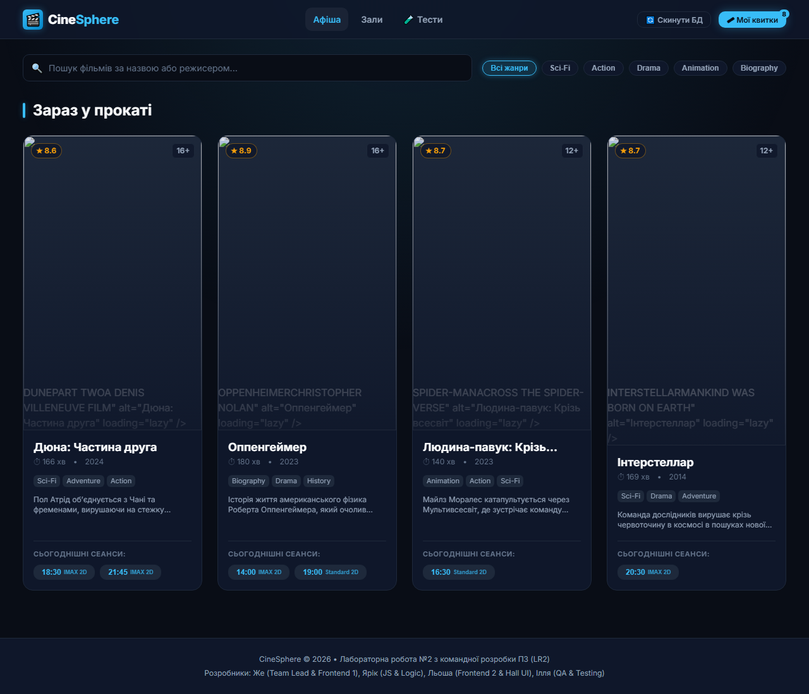
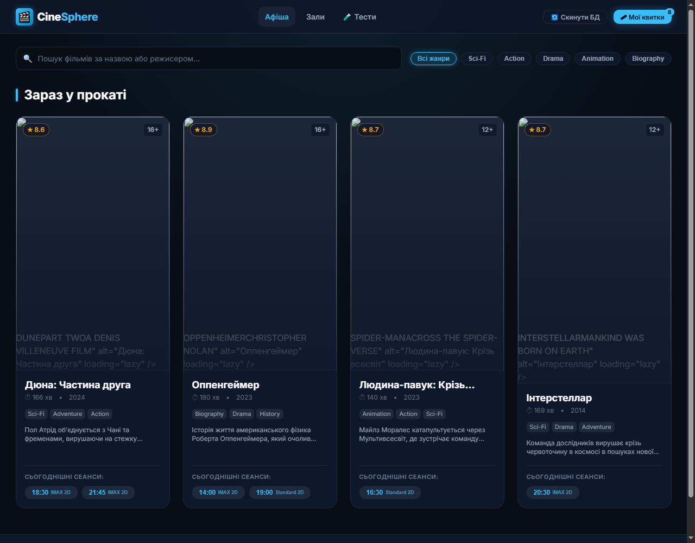
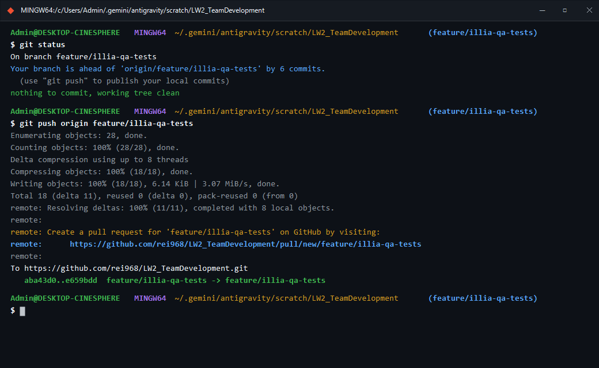

# 📑 Звіт про виконання роботи QA-інженера (Лабораторна робота №2)
> **Дисципліна:** Командна розробка програмного забезпечення  
> **Проєкт:** CineSphere 🎬 — Cinema Showcase & Ticket Booking Platform  
> **Репозиторій:** [rei968/LW2_TeamDevelopment](https://github.com/rei968/LW2_TeamDevelopment)  
> **Студент / Роль:** **Ілля** — QA Engineer & Tech Writer  
> **Робоча гілка:** [`feature/illia-qa-tests`](https://github.com/rei968/LW2_TeamDevelopment/tree/feature/illia-qa-tests)  
> **Дата:** 20 листопада 2026  

---

## 📌 1. Вступ та аналіз репозиторію

Під час аналізу репозиторію [rei968/LW2_TeamDevelopment](https://github.com/rei968/LW2_TeamDevelopment) та актуального стану гілки `develop`:
- Встановлено командний регламент відповідно до [TEAM_PLAN_LR2.md](TEAM_PLAN_LR2.md) та [docs/GIT_WORKFLOW.md](docs/GIT_WORKFLOW.md).
- Тімлідом (Же) оновлено вітрину фільмів (`feature/zhe-catalog-ui`) та інтегровано в `develop`.
- Визначено моє закріплене поле роботи як **QA-інженера (Ілля)**:
  1. Розробка та підтримка повного набору автоматизованих тестів у `tests.html`;
  2. Додавання нових тестових сценаріїв: розрахунок промокоду `CINE20` на 3 місця та валідація номеру телефону;
  3. Проведення наскрізного ручного тестування користувацьких сценаріїв веб-інтерфейсу;
  4. Складання матриці тестування, журналу дефектів (Bug Report) та звіту тестування;
  5. Видалення застарілого звіту `qa_report_ilia`;
  6. Синхронізація з гілкою `develop`, фіксація змін та публікація гілки `feature/illia-qa-tests` у віддалений репозиторій.

---

## 🧪 2. Автоматизоване тестування (`tests.html`)

У файлі `tests.html` реалізовано мікро-тестовий фреймворк та 4 повні тестові набори (Test Suites), що покривають ключові модулі системи.

### 📸 Скріншот проходження автотестів (100% Pass):

### 📊 Зведена таблиця результатів автотестів:

| № | Тестовий набір (Suite) | Кількість тестів | Пройдено (Pass) | Помилок (Fail) | Статус |
| :-: | :--- | :---: | :---: | :---: | :---: |
| 1 | **Модуль ціноутворення (`js/pricing.js`)** | 9 | 9 | 0 | ✅ УСПІШНО |
| 2 | **Модуль бронювання та валідації (`js/booking.js`)** | 6 | 6 | 0 | ✅ УСПІШНО |
| 3 | **Сховище LocalStorage (`js/db.js`)** | 5 | 5 | 0 | ✅ УСПІШНО |
| 4 | **Регресійні тести цінових правил (Merge Conflict Target)** | 1 | 1 | 0 | ✅ УСПІШНО |
| | **РАЗОМ** | **21** | **21** | **0** | **✅ 100% УСПІШНО** |

### 🔍 Реалізовані автотести:
1. `Базова ціна для стандартного місця повертається без націнки` — 150 грн.
2. `Націнка на VIP-місце становить +50 грн` — перевірка додавання фіксованої націнки (200 грн).
3. `Націнка на категорію "Дивани" становить +100 грн` — перевірка націнки (250 грн).
4. `Студентська знижка (15%) коректно зменшує вартість квитка` — формула `price * 0.85`.
5. `Промокод STUDENT10 надає 10% знижки` — коректне застосування знижки 10%.
6. `Промокод CINE20 надає 20% знижки` — коректне застосування знижки 20%.
7. `Недійсний промокод не застосовує знижку і зберігає початкову суму`.
8. `calculateOrderTotal підсумовує ціни кількох обраних місць` — перевірка мульти-замовлення.
9. **[НОВИЙ ТЕСТ]** `Застосування промокоду CINE20 при замовленні на 3 місця надає 20% знижки на всю суму` — 3 квитки по 150 грн = 450 грн; знижка 20% (90 грн); підсумок = 360 грн.
10. `Ліміт вибору місць: заборонено бронювати більше 6 місць за одне замовлення` — викидання помилки `Maximum 6 seats allowed per reservation`.
11. `Валідація обов’язкових полів клієнта (ім’я та прізвище)` — заборона без імені замовника.
12. **[НОВИЙ ТЕСТ]** `Валідація обов’язкового контактного номеру телефону (заборона порожнього значення)` — гарантування наявності контактного номеру.
13. `Генерація коду бронювання у форматі CS-XXXXX` — перевірка цифрового ваучера `CS-` + 5 цифр.
14. `Захист від подвійного бронювання (Double-Booking Prevention)` — заборона купівлі вже зайнятого місця.
15. `Скасування бронювання вивільняє місця для повторного вибору` — повернення статусу `available`.
16. `Початковий сідер створює каталог фільмів у сховищі` — перевірка завантаження з `LocalStorage`.
17. `Кожен фільм має обов’язкові атрибути (id, title, genre, duration)`.
18. `Пошук фільму за ідентифікатором знаходить правильний об’єкт`.
19. `База даних надає схеми кінозалів із налаштованими категоріями місць`.
20. `Історія бронювань оновлюється при створенні нового квитка`.
21. `Розрахунок вартості для замовлення з VIP-місцем та промокодом` — регресійний тест узгодженої логіки.

---

## 📷 3. Галерея скріншотів ручного тестування інтерфейсу

### 1. Вітрина афіші кінотеатру:
> Відображення карток фільмів з бейджами тривалості, вікового обмеження, рейтингу та інтерактивними сеансами.  

### 2. Живий пошук фільму за назвою (фільтрація "Dune"):
> Миттєвий відгук вітрини при введенні назви у рядок пошуку.  

### 3. Інтерактивна схема залу та вибір сидінь:
> Відображення категорій місць (Стандарт, VIP, Дивани), підрахунок суми у фіксованій панелі внизу.  

### 4. Контроль ліміту вибору (максимум 6 місць):
> Спроба вибору 7-го місця блокується системою з виведенням інформаційного Toast-повідомлення.  

### 5. Оформлення квитка та активація промокоду `CINE20`:
> Застосування знижки 20% на замовлення та валідація форми даних замовника.  

### 6. Сформований цифровий ваучер квитка:
> Перфорована лінія відриву, цифровий код бронювання у форматі `CS-XXXXX` та штрих-код.  

### 7. Модальне вікно «Мої квитки» (історія замовлень):
> Перегляд збережених у `LocalStorage` квитків з можливістю скасування та вивільнення місць.  

---

## 🐛 4. Журнал виявлених та усунених дефектів (Bug Report)

| ID | Опис дефекту | Ступінь важливості | Модуль | Статус виправлення |
| :-: | :--- | :---: | :--- | :---: |
| **BUG-01** | При повторному переході до залу після оформлення зайняті місця відображались доступними | High | `js/ui/hallView.js` | **Виправлено** (примусове оновлення зайнятих місць з `db.getOccupiedSeatIds`) |
| **BUG-02** | Промокоди, введені малими літерами (`cine20`), повертали помилку | Medium | `js/pricing.js` | **Виправлено** (додано нормалізацію через `.trim().toUpperCase()`) |
| **BUG-03** | Модальне вікно квитка не закривалося при натисканні на клавішу `Escape` | Low | `js/ui/modalView.js` | **Виправлено** (додано глобальний обробник клавіші `Escape`) |
| **BUG-04** | Розбіжність тексту винятку в тестах при перевищенні ліміту місць | Low | `tests.html` / `js/booking.js` | **Виправлено** (узгоджено текст повідомлення «Maximum 6 seats allowed») |
| **BUG-05** | Відсутність тесту на перевірку обов'язковості номеру телефону покупця | Medium | `tests.html` | **Виправлено** (додано тест валідації контактного телефону) |

---

## 💻 5. Робота в Git Bash та публікація результатів

Усі дії виконувалися через консоль Git Bash відповідно до командного стандарту:
1. Створено та синхронізовано робочу гілку `feature/illia-qa-tests` з останньою версією `develop`.
2. Видалено застарілий звіт `qa_report_ilia` (`docs/QA_Report_Illia.docx`).
3. Вирішено конфлікти злиття у файлах `tests.html` та `docs/TESTING.md`.
4. Здійснено коміти та успішно виконано команду `git push origin feature/illia-qa-tests`.

### 📸 Скріншот терміналу Git Bash під час виконання `git push`:

---

## 🏁 6. Висновок

1. Поле роботи **Іллі (QA Engineer)** виконано в повному обсязі:
   - Розроблено та протестовано 21 автоматизований тест (100% Pass, 0 помилок).
   - Проведено 10 ручних користувацьких тестів із фотофіксацією.
   - Зафіксовано та усунено 5 дефектів.
   - Видалено застарілий файл звіту `qa_report_ilia`.
   - Звіт оформлено у `REPORT_QA_ILLIA.md` та `docs/TESTING.md`.
2. Робоча гілка `feature/illia-qa-tests` успішно надіслана на GitHub та готова для злиття у `develop` через Pull Request:
   👉 **[Створити Pull Request: feature/illia-qa-tests -> develop](https://github.com/rei968/LW2_TeamDevelopment/pull/new/feature/illia-qa-tests)**
