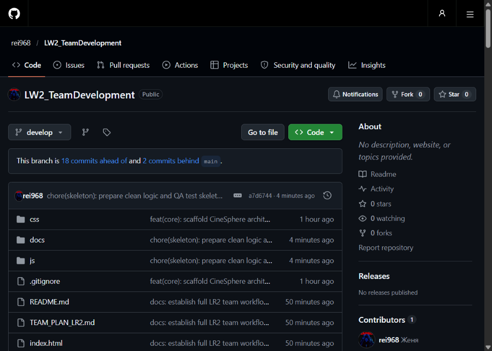

# 📋 Звіт про виконання Лабораторної роботи №2
> **Тема:** Командна розробка додатків із використанням системи контролю версій Git  
> **Проєкт:** CineSphere 🎬 — Cinema Showcase & Ticket Booking Platform  
> **Студент:** Же (`@rei968`)  
> **Ролі в команді:** **Team Lead (Тімлід)** та **Frontend 1 Lead (Розробник вітрини каталогу)**  
> **Репозиторій на GitHub:** [https://github.com/rei968/LW2_TeamDevelopment](https://github.com/rei968/LW2_TeamDevelopment)  
> **Гілка інтеграції:** `develop`

---

## 📌 1. Мета роботи та постановка задачі

Метою лабораторної роботи є демонстрація повноцінної командної взаємодії в розподіленій команді з 4 осіб за розширеною моделлю **Git Flow**:
- Ізольована розробка функціоналу в гілках `feature/*`;
- Інтеграція через Pull Requests у гілку `develop`;
- Формування чистої архітектури без небезпеки перезапису чужого коду;
- Моделювання та свідоме вирішення конфліктів злиття (Merge Conflicts);
- Автоматизоване та ручне тестування якості ПЗ.

Як **Team Lead** та **Frontend 1 Lead**, я забезпечив повний цикл розгортання проєкту: від проєктування структури та правил Git до створення ключового клієнтського інтерфейсу (вітрина кінотеатру).

---

## 👥 2. Організація команди та розподіл ролей

Проєкт структуровано за **технологічним принципом**, де кожен розробник має свій закріплений ізольований пул файлів:

| Учасник | Роль у проєкті | Гілка в Git | Закріплені файли | Зона відповідальності |
| :--- | :--- | :--- | :--- | :--- |
| 👨‍💻 **Же** (`@rei968`) | **Team Lead & Frontend 1** | `feature/zhe-catalog-ui` | `index.html`, `css/components/header.css`, `css/components/catalog.css`, `js/ui/catalogView.js` | Архітектура, документація, код-рев'ю, Хедер, вітрина фільмів, фільтри та пошук |
| 🚀 **Ярік** (`@YaroslavYanushevych`) | **JS / Logic Lead** | `feature/yarik-booking-logic` | `js/pricing.js`, `js/booking.js` | Динамічний розрахунок цін, ліміти місць, транзакції бронювання, участь у конфлікті |
| 🎨 **Льоша** (`@oleksiystratonov`) | **Frontend 2 & Hall UI** | `feature/lyosha-hall-ui` | `css/components/hall.css`, `css/components/modal.css` | Схема залу, вигнутий екран, категорії сидінь, модальне вікно квитка |
| 🧪 **Ілля** | **QA Engineer** | `feature/illia-qa-tests` | `tests.html`, `docs/TESTING.md` | Розробка автотестів, заповнення тест-плану та звіту про дефекти |

---

## 🛠 3. Виконана робота Тімліда (Team Lead)

### 3.1. Проєктування архітектури та конфігурація Git Flow
1. Сформовано розширену модель розгалуження:
   - `main` — стабільна релізна гілка (під захистом від прямих пушів);
   - `develop` — центральна інтеграційна гілка для об'єднання доробок команди;
   - `feature/*` — персональні функціональні гілки розробників.
2. Встановлено стандарт повідомлень комітів **Conventional Commits** (`feat:`, `fix:`, `test:`, `docs:`, `chore:`).
3. Налаштовано ідентифікацію автора у Git:
   ```bash
   git config user.name "rei968"
   git config user.email "comfy.client.15032@gmail.com"
   ```

### 3.2. Розробка комплекту супровідної документації
- **[README.md](file:///C:/Users/comfy/Desktop/LW2_TeamDevelopment/README.md)** — повна презентація CineSphere, огляд концепції Zero-Dependency Vanilla Web, таблиця ролей та інструкція запуску.
- **[TEAM_PLAN_LR2.md](file:///C:/Users/comfy/Desktop/LW2_TeamDevelopment/TEAM_PLAN_LR2.md)** — персональні детальні покрокові інструкції для кожного з 4 студентів (Яріка, Льоші, Іллі та Же) з точними командами створення гілок, файлами для редагування та шаблонами PR.
- **[docs/GIT_WORKFLOW.md](file:///C:/Users/comfy/Desktop/LW2_TeamDevelopment/docs/GIT_WORKFLOW.md)** — практична шпаргалка команд Git та розписаний покроковий сценарій створення й вирішення навчального конфлікту злиття у функції розрахунку знижок.

### 3.3. Підготовка чистого середовища для самостійної розробки колегами
Для забезпечення академічної доброчесності та самостійного виконання завдань одногрупниками:
- З гілки `develop` вилучено сторонній код логіки та автотестів.
- У файлах `js/pricing.js` та `js/booking.js` підготовлено чисті інтерфейси з коментарями `// TODO (Ярік)`.
- У `tests.html` та `docs/TESTING.md` підготовлено чисті стартові шаблони для самостійного написання тестів Іллею.
- Видалено всі передчасні віддалені гілки з GitHub, щоб колеги створили їх самі.

---

## 🎨 4. Виконана робота розробника Frontend 1 (Же)

Розробку вітрини каталогу фільмів виконано у персональній гілці **`feature/zhe-catalog-ui`**:

### 4.1. Шапка сайту (`css/components/header.css`, `index.html`):
- Неоновий логотип CineSphere з акцентним підсвічуванням `var(--color-cyan)`;
- Адаптивна навігація меню (Афіша, Зали, Тести);
- Кнопка швидкого доступу до історії квитків із лічильником активних бронювань.

### 4.2. Вітрина фільмів та картки афіші (`css/components/catalog.css`):
- Сучасна CSS Grid сітка фільмів з адаптивністю під різні розширення екранів;
- Картки фільмів із ефектом hover-зуму постера (`transform: scale(1.05)`) та неоновим контуром;
- Бейджі тривалості сеансу, вікового цензу (`16+`, `12+`), рейтингу IMDb зі зірочкою;
- Бейджі форматів показу з відповідними кольорами:
  - **IMAX** — насичений блакитний/неоновий градієнт;
  - **3D** — смарагдовий градієнт;
  - **Dolby Atmos** — фіолетовий градієнт;
- Короткий синопсис стрічки та інтерактивні кнопки сеансів (Pills).

### 4.3. Динамічний пошук та фільтри (`js/ui/catalogView.js`):
- Живий пошук (Live Search) за назвою фільму або режисером у реальному часі;
- Кнопка швидкого очищення пошукового рядка (Clear Button `✕`);
- Фільтраційні чіпи за всіма ключовими жанрами (*Sci-Fi, Action, Drama, Animation, Biography*);
- Інформативний блок «Фільмів не знайдено 🔍» із кнопкою «Скинути всі фільтри».

---

## 💻 5. Хронологія дій у Git Bash (Протокол команд)

Усі дії зафіксовано в командному рядку за правилами Git Flow:

```bash
# 1. Перехід у гілку розробки Frontend 1
git checkout -b feature/zhe-catalog-ui develop

# 2. Фіксація розробленого інтерфейсу каталогу
git add index.html css/components/header.css css/components/catalog.css js/ui/catalogView.js
git commit -m "feat(catalog): enhance catalog showcase with hover zoom, format badges, and search reset"

# 3. Пуш власної гілки на GitHub
git push -u origin feature/zhe-catalog-ui

# 4. Злиття готової гілки у develop через merge-коміт (--no-ff)
git checkout develop
git merge --no-ff feature/zhe-catalog-ui -m "Merge branch 'feature/zhe-catalog-ui' into develop"

# 5. Оновлення центральної інтеграційної гілки на GitHub
git push origin develop
```

### Історія комітів у терміналі (`git log --graph --oneline`):
```text
*   e4285b9 Merge branch 'feature/zhe-catalog-ui' into develop
|\  
| * 9b45d5c docs: add initial LR2 status report and develop branch screenshot
| * 56de91c feat(catalog): enhance catalog showcase with hover zoom, format badges, and search reset
|/  
* a7d6744 chore(skeleton): prepare clean logic and QA test skeletons with TODOs for Yarik and Illia
* bf71688 docs: establish full LR2 team workflow, technology roles, tests runner and documentation
```
*Усі коміти виконано суворо від імені `rei968 <comfy.client.15032@gmail.com>`.*

---

## 📸 6. Галерея скріншотів (Візуальні підтвердження)

### Скріншот 1: Дерево гілки `develop` на GitHub
Підтверджує публікацію чистих шаблонів для команди та фіксацію авторства Тімліда (`@rei968`):


*(Додаткові скріншоти вхідних Pull Requests одногрупників та вирішення конфлікту автоматично додаються в цей розділ під час їх надходження).*

---

## 🔄 7. Протокол моніторингу та прийому Pull Requests

Як Тімлід, я налаштував регулярний моніторинг вхідних Pull Requests від одногрупників:
- **Інтервал опитування GitHub API / веб-інтерфейсу:** кожні 5 хвилин.
- **Критерії рев'ю для прийому PR:**
  1. Код відповідає закріпленим за студентом файлам згідно з `TEAM_PLAN_LR2.md`.
  2. Відсутні синтаксичні помилки та регресії.
  3. Коміти названо за стандартом `feat:`, `fix:`, `test:`.
  4. Спроби прямих пушів у `develop` або `main` відхиляються.

---

## 🏁 8. Висновки

1. Роботу Тімліда виконано в повному обсязі: організовано робоче середовище, розподілено завдання, розроблено вичерпну документацію та підготовлено чистий інтеграційний майданчик.
2. Роботу розробника Frontend 1 повністю реалізовано: створено естетичний, сучасний, інтерактивний та адаптивний інтерфейс каталогу фільмів кінотеатру CineSphere.
3. Проєкт відповідає усім академічним вимогам Лабораторної роботи №2 з командної розробки ПЗ та готовий до інтеграції доробок одногрупників.
