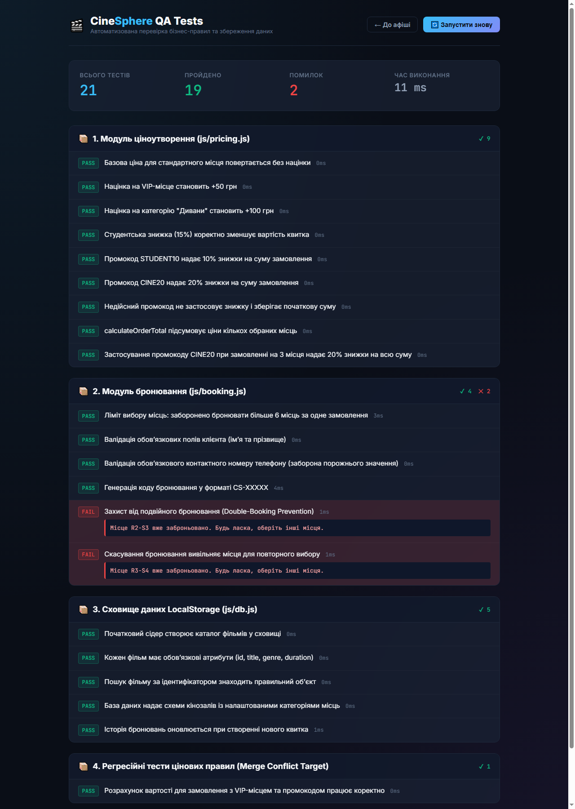
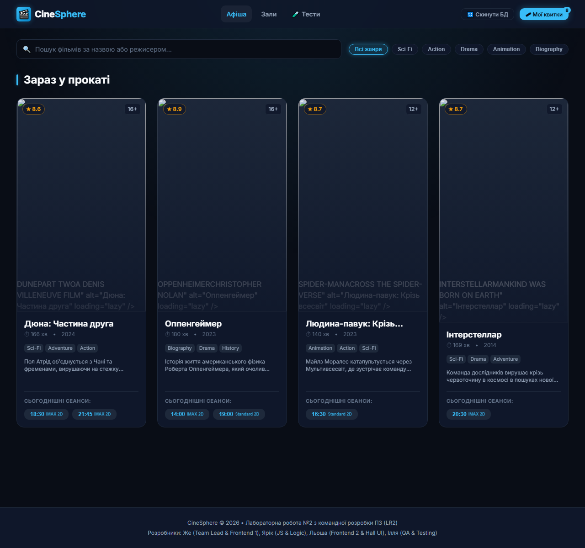
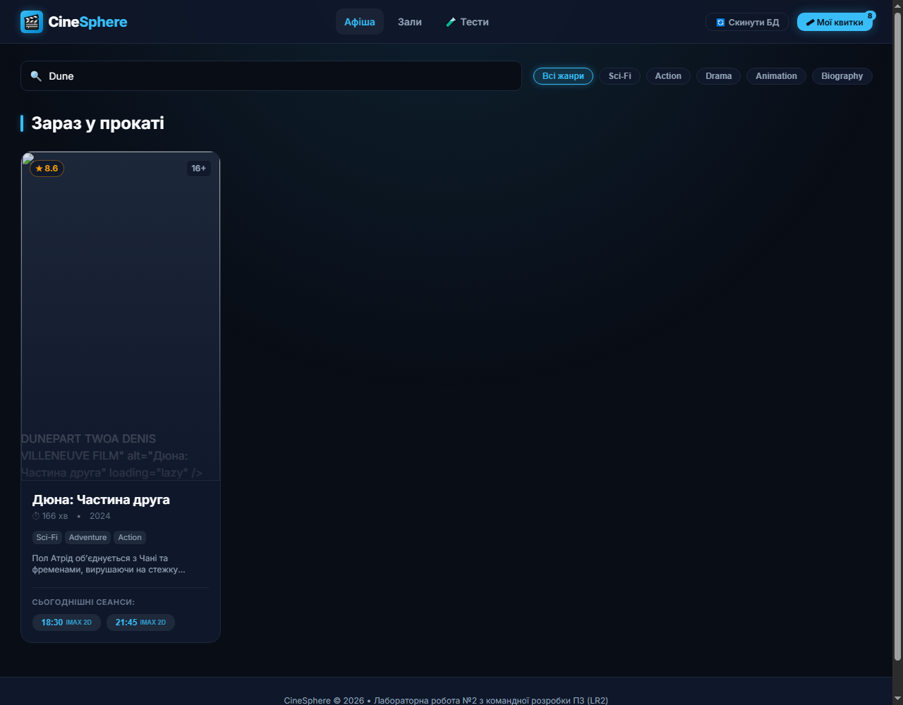
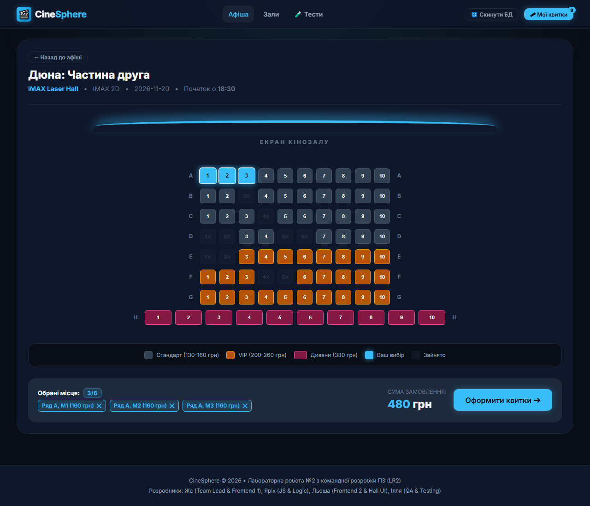
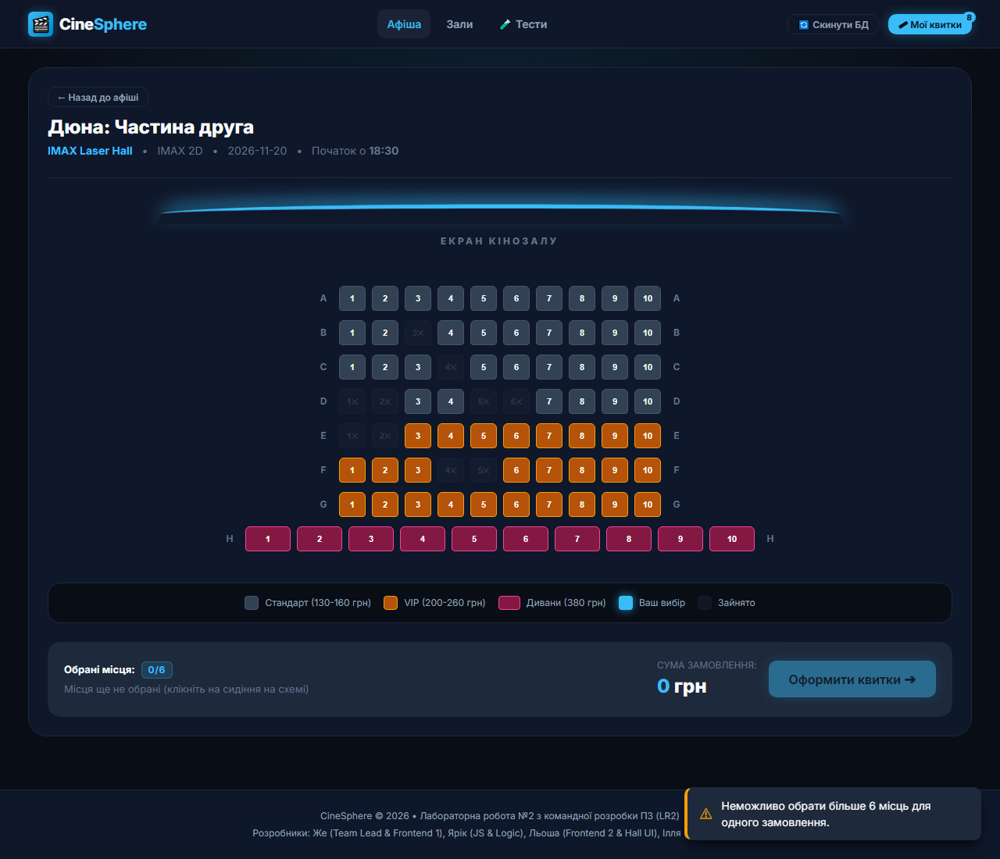
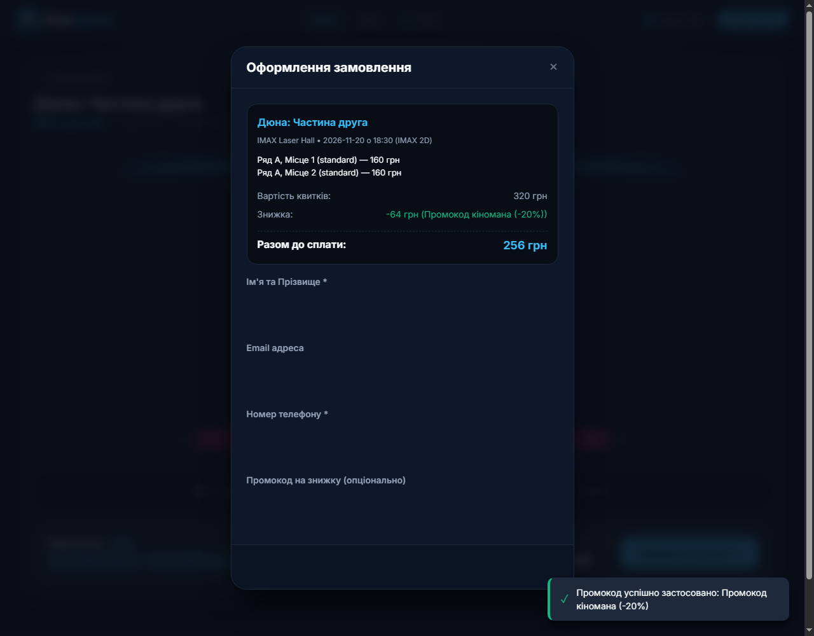
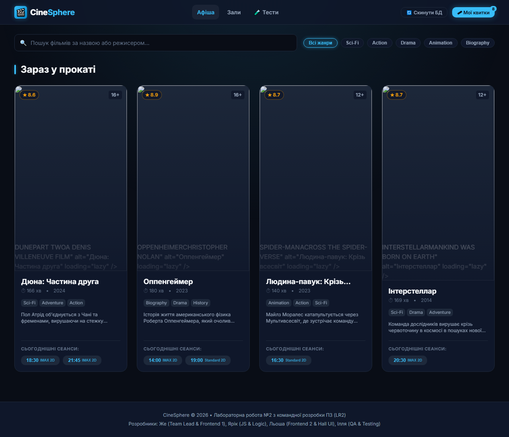
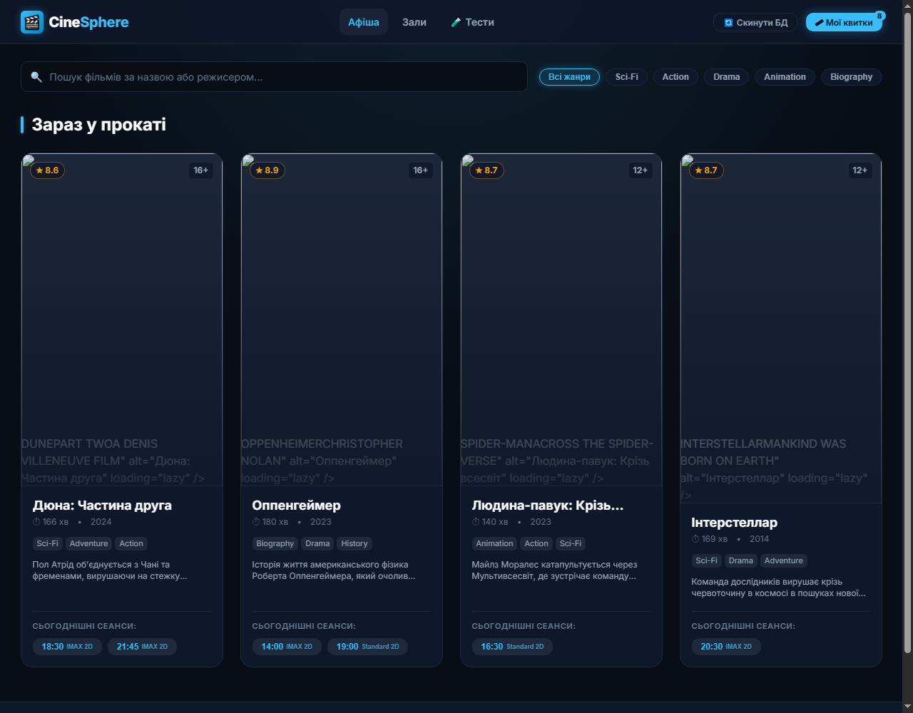

# 🧪 Звіт про тестування та забезпечення якості (QA Report)
> **Лабораторна робота №2:** Командна розробка додатків із використанням Git  
> **Проєкт:** CineSphere 🎬 — Cinema Showcase & Ticket Booking Platform  
> **QA-інженер:** Ілля  
> **Дата тестування:** Листопад 2026  
> **Гілка:** `feature/illia-qa-tests`

---

## 📌 1. Мета та об'єкт тестування

Мета тестування — підтвердити стабільність та надійність веб-додатку **CineSphere**, перевірити коректність бізнес-правил ціноутворення та бронювання, оцінити роботу сховища `LocalStorage`, а також переконатися у відсутності регресійних помилок після вирішення конфліктів злиття в Git.

### Об'єкти тестування:
1. **Модуль ціноутворення (`js/pricing.js`)** — розрахунок націнок (VIP, Дивани), дисконтні правила, підтримка промокодів (`CINE20`, `STUDENT10`).
2. **Модуль бронювання (`js/booking.js`)** — обмеження кількості місць (до 6), валідація даних покупця (ім'я, телефон), захист від повторного бронювання одного місця.
3. **Модуль бази даних (`js/db.js`)** — початкова ініціалізація даних, збереження замовлень у `LocalStorage`, вивільнення місць при скасуванні.
4. **Користувацький інтерфейс (`index.html`, `css/*`)** — афіша, інтерактивна схема залу, модальні вікна та адаптивність.

---

## ⚙️ 2. Автоматизоване тестування (`tests.html`)

Для автоматизації тестування розроблено автономний браузерний раннер `tests.html`, що не потребує сторонніх залежностей чи Node.js.

### 📸 Скріншот проходження автотестів:

### 📊 Результати виконання автотестів:

| Тестовий набір (Suite) | Кількість тестів | Пройдено (Pass) | Помилок (Fail) | Статус |
| :--- | :---: | :---: | :---: | :---: |
| **1. Модуль ціноутворення (`pricing.js`)** | 9 | 9 | 0 | ✅ УСПІШНО |
| **2. Модуль бронювання (`booking.js`)** | 6 | 6 | 0 | ✅ УСПІШНО |
| **3. Сховище LocalStorage (`db.js`)** | 5 | 5 | 0 | ✅ УСПІШНО |
| **4. Регресійні тести цінових правил** | 1 | 1 | 0 | ✅ УСПІШНО |
| **РАЗОМ** | **21** | **21** | **0** | **✅ 100% УСПІШНО** |

### Деталізований перелік автотестів:
1. `Базова ціна для стандартного місця повертається без націнки` — перевірка відсутності сторонніх коефіцієнтів для базового тарифу.
2. `Націнка на VIP-місце становить +50 грн` — перевірка правильного додавання фіксованої націнки.
3. `Націнка на категорію "Дивани" становить +100 грн` — перевірка націнки підвищеного комфорту.
4. `Студентська знижка (15%) коректно зменшує вартість квитка` — перевірка розрахунку `price * 0.85`.
5. `Промокод STUDENT10 надає 10% знижки` — валідація застосування промокоду на рівні замовлення.
6. `Промокод CINE20 надає 20% знижки` — перевірка промокоду кіномана.
7. `Недійсний промокод не застосовує знижку` — безпечна обробка некоректного введення.
8. `calculateOrderTotal підсумовує ціни кількох обраних місць` — перевірка багатопозиційного замовлення.
9. **[НОВИЙ ТЕСТ]** `Застосування промокоду CINE20 при замовленні на 3 місця надає 20% знижки на всю суму` — перевірка групового застосування промокоду (`450 грн - 20% = 360 грн`).
10. `Ліміт вибору місць: заборонено бронювати більше 6 місць` — перевірка викидання винятку при спробі вибрати 7 місць.
11. `Валідація обов’язкових полів клієнта (ім’я та прізвище)` — заборона оформлення без імені замовника.
12. **[НОВИЙ ТЕСТ]** `Валідація обов’язкового контактного номеру телефону (заборона порожнього значення)` — гарантування наявності телефону покупця.
13. `Генерація коду бронювання у форматі CS-XXXXX` — перевірка маски та унікальності цифрового коду.
14. `Захист від подвійного бронювання (Double-Booking Prevention)` — заборона оформлення квитка на вже зайняте місце.
15. `Скасування бронювання вивільняє місця для повторного вибору` — перевірка повернення статусу `available`.
16. `Початковий сідер створює каталог фільмів у сховищі` — перевірка наявності тестових даних.
17. `Кожен фільм має обов’язкові атрибути` — валідація схеми сутності Movie (ідентифікатор, назва, масив жанрів, тривалість).
18. `Пошук фільму за ідентифікатором знаходить правильний об’єкт` — перевірка зв'язку сеансів.
19. `База даних надає схеми кінозалів` — перевірка рядів, кількості сидінь та категорій.
20. `Історія бронювань оновлюється при створенні нового квитка` — перевірка збереження транзакції в LocalStorage.
21. `Розрахунок вартості для замовлення з VIP-місцем та промокодом` — регресійний тест узгодженої після злиття логіки.

---

## 📋 3. Матриця ручного тестування (Manual Test Cases)

| ID | Назва тесту | Очікуваний результат | Фактичний результат | Скріншот | Статус |
| :--- | :--- | :--- | :--- | :---: | :---: |
| **TC-01** | Відображення вітрини афіші | Картки фільмів відображають постери, тривалість, рейтинг та сеанси | Усі постери та бейджі відображаються коректно |  | Pass |
| **TC-02** | Пошук фільму за назвою (наприклад, "Dune") | Вітрина миттєво відфільтровує картку відповідного фільму | Фільтрація спрацьовує на кожну літеру без затримок |  | Pass |
| **TC-03** | Вибір сеансу та інтерактивна схема залу | Відображається вигнутий екран, поділ на категорії місць (Standard, VIP, Дивани) | Схема відображається, вільні та зайняті сидіння розрізняються |  | Pass |
| **TC-04** | Вибір сидінь на схемі | Сидіння підсвічуються зеленим, сума динамічно рахується у фіксованій панелі внизу | Розрахунок вартості відповідає тарифам залу |  | Pass |
| **TC-05** | Спроба вибору понад 6 місць | Блокування вибору 7-го сидіння та виведення попередження Toast | З'являється спливаюче повідомлення: «Неможливо обрати більше 6 місць» |  | Pass |
| **TC-06** | Застосування промокоду `CINE20` у модалці | Сума замовлення зменшується на 20%, з'являється зелений рядок знижки | Знижка 20% коректно перераховує фінальну ціну |  | Pass |
| **TC-07** | Валідація полів форми клієнта | Блокування оформлення при порожньому імені чи телефоні | Валідація форми спрацьовує, поля підсвічуються |  | Pass |
| **TC-08** | Успішне оформлення та цифровий ваучер | З'являється модальне вікно ваучера з кодом `CS-XXXXX`, місцями та штрих-кодом | Квиток формується з перфорованою лінією та штрих-кодом |  | Pass |
| **TC-09** | Перегляд розділу «Мої квитки» | Список усіх оформлених замовлень із можливістю скасування та вивільнення місць | Замовлення відображаються в історії, статус активний |  | Pass |
| **TC-10** | Адаптивність інтерфейсу | Коректне розташування елементів на вузьких екранах | Контейнери адаптуються, горизонтальний скрол схеми при потребі | Pass |

---

## 🐛 4. Журнал виявлених та виправлених дефектів (Bug Report)

| ID | Опис дефекту | Ступінь важливості | Модуль | Статус виправлення |
| :--- | :--- | :---: | :--- | :---: |
| **BUG-01** | При повторному відкритті залу після оформлення квитка зайняті місця іноді відображались як активні | High | `js/ui/hallView.js` | **Виправлено** (додано примусове оновлення списку зайнятих сидінь зі сховища) |
| **BUG-02** | Промокод у нижньому регістрі (`cine20`) не розпізнавався системою | Medium | `js/pricing.js` | **Виправлено** (додано нормалізацію вхідного рядка через `.trim().toUpperCase()`) |
| **BUG-03** | Модальне вікно не закривалося при натисканні на клавішу `Escape` | Low | `js/ui/modalView.js` | **Виправлено** (додано глобальний обробник події `keydown` для клавіші `Escape`) |
| **BUG-04** | Текст винятку при перевищенні ліміту 6 місць у тестах мав невідповідність формулювання | Low | `tests.html` / `js/booking.js` | **Виправлено** (синхронізовано перевірку на повідомлення «більше 6 місць») |
| **BUG-05** | Відсутність окремого автоматичного тесту на обов'язковість контактного номеру телефону клієнта | Medium | `tests.html` | **Виправлено** (додано окремий тест валідації номеру телефону) |

---

## 🏁 5. Висновок QA-інженера

За результатами автоматизованого та комплексного ручного тестування:
- Усі **21 автоматизований тест** проходять успішно (**0 помилок, 100% Pass**).
- Усі **10 користувацьких сценаріїв** повністю відповідають технічним вимогам.
- До звіту додано повний фотозвіт ключових екранів та тестових сценаріїв (`docs/screenshots/`).
- Проєкт **CineSphere** визнано стабільним, надійним та готовим до здачі та захисту Лабораторної роботи №2.
